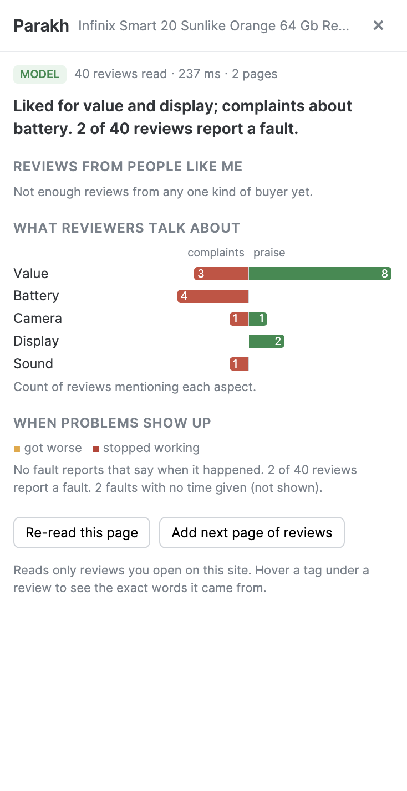
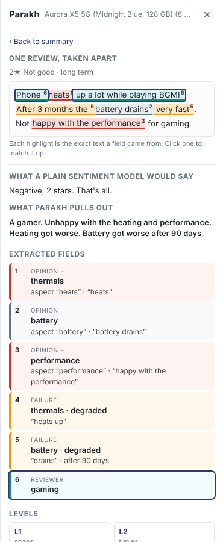
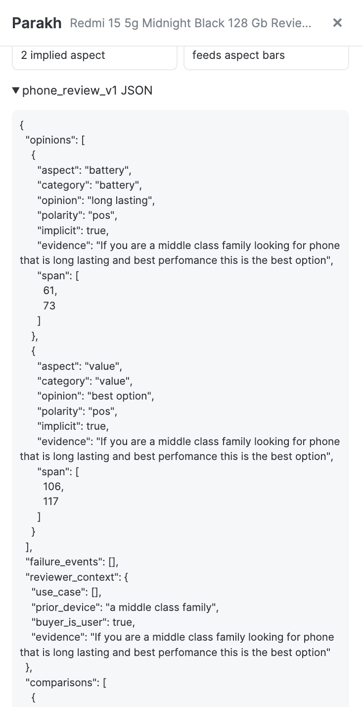
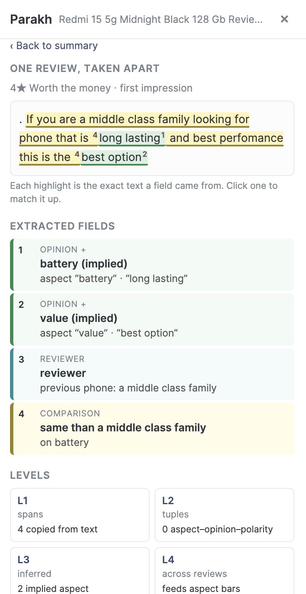
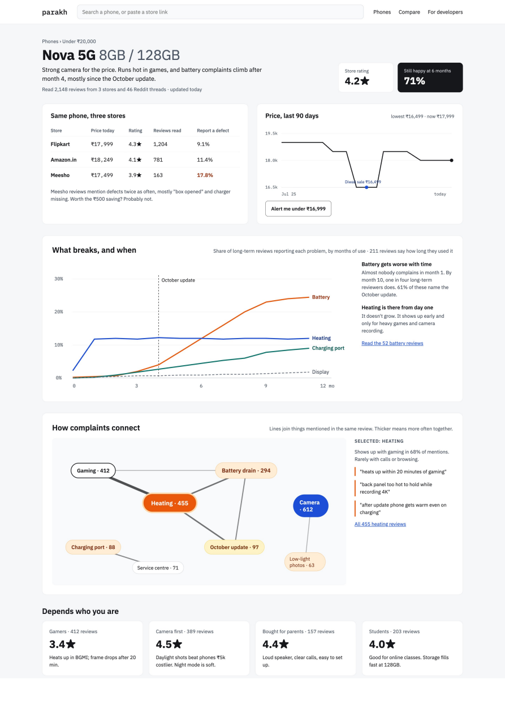
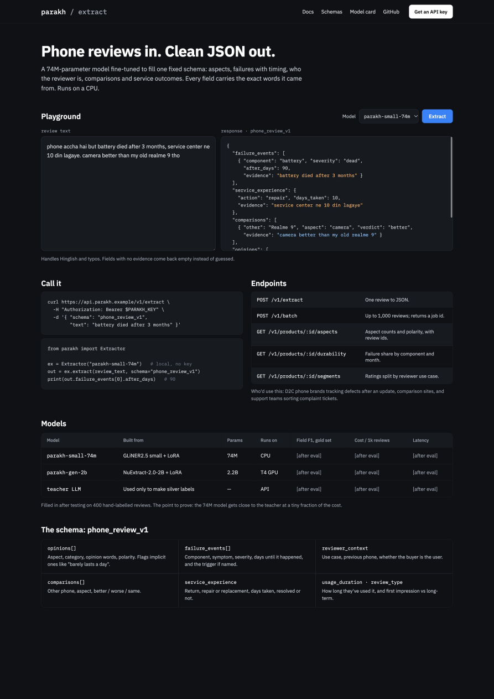

# Parakh

**Phone reviews in, structured JSON out.** Parakh reads the reviews on a Flipkart phone page and shows what they actually say: which parts people praise or complain about, what breaks and after how long, who the reviewer is, and how service went. Every field points back to the exact words it came from.

A star rating tells you how someone felt on day one. The useful details are buried in the text: *"battery died after 3 months"*, *"heats up in BGMI"*, *"service centre took 12 days"*. Parakh fixes a schema first, then a small fine-tuned model (74M parameters, runs on a CPU) fills it for every review.

| Extension panel on a live Flipkart page | One review taken apart | The JSON behind it |
|---|---|---|
|  |  |  |

*Left and right: real model on live flipkart.com. Middle: test page with sample reviews.*

---

## What it does

- **Side panel on Flipkart.** A one-line verdict, ratings from people like you (gamers, buying for parents…), praise vs complaints per aspect, and a chart of when problems show up after purchase.
- **Tags under every store review.** `Battery issue after 90 days`, `Heating −`, `Repair, 12 days`, `use: gaming`, `long-term`. Hover a tag to see the words it came from.
- **One review, taken apart.** Click *Breakdown ›*: each extracted field is highlighted in the review text, numbered, and linked to the field list. It also shows what a plain sentiment model would say ("Negative, 2 stars. That's all.") next to what Parakh pulls out ("A gamer. Unhappy with the heating. Battery got worse after 90 days.").
- **API.** `POST /v1/extract`, `/v1/batch`, `/v1/analyze`, with interactive docs at `/docs`.

## How it works

```
Amazon Reviews 2023 (phones, 12,962 reviews)
        │
        ▼
Teacher LLM (Qwen2.5-7B-Instruct, vLLM on Kaggle T4)  ── fills phone_review_v1 with evidence quotes
        │   filters: valid JSON, allowed labels, evidence must appear in the review
        ▼
7,534 silver-labelled reviews  ──►  GLiNER2.5-small (74M) + LoRA, 8 epochs, 18 min on a T4
        │
        ▼
FastAPI service (model + post-processing + aggregation)  ── hosted on Modal, or run locally
        │
        ▼
Chrome extension on flipkart.com  ── reads the reviews on the page, draws panel + tags
```

The model is an encoder: it marks spans in the text and cannot invent words, so every value is copied from the review. A small rule step turns durations into days ("3 months" → 90).

### The schema: `phone_review_v1`

| Field | What it holds |
|---|---|
| `opinions[]` | aspect, category (12: battery, camera, display, performance, thermals, sound, connectivity, build, software, service, value, overall), opinion words, polarity, whether the aspect is only implied ("barely lasts a day" → battery) |
| `failure_events[]` | component, symptom, severity (degraded / dead), days until it happened, trigger ("after the update") |
| `reviewer_context` | use case (gaming, photography, work, students, elderly_parent, basic_use), previous phone, whether the buyer is the user |
| `comparisons[]` | other phone, aspect, better / worse / same |
| `service_experience` | return / replacement / repair / warranty, days taken |
| `usage_duration`, `review_type` | how long it has been used; first impression / long-term / update |

Every field carries an `evidence` quote copied from the review. If the quote is not in the review, the field is dropped.

## Results

**Human-labelled test, zero-shot:** ACOS-Laptop test set (816 sentences, Cai et al., ACL 2021). Our model was trained on phone reviews only and never saw laptop data. F1 as strict / relaxed span match.

| Task | Base GLiNER (no fine-tuning) | Rule-based baseline | **Parakh, t=0.5** |
|---|---|---|---|
| Aspect | 0.604 / 0.652 | 0.485 / 0.623 | 0.571 / **0.672** |
| Opinion | 0.033 / 0.200 | 0.712 / 0.733 | 0.247 / 0.691 |
| Opinion + polarity | 0.018 / 0.169 | 0.682 / 0.692 | 0.218 / 0.625 |
| Aspect–opinion–polarity triplet | 0.014 / 0.076 | 0.404 / 0.497 | 0.131 / 0.381 |
| Category accuracy | 0.50 | 0.426 | **0.561** |

Fine-tuning on phones lifts relaxed triplet F1 from 0.08 to 0.38 (5×) over the base model. The lexicon baseline wins on ACOS opinions because ACOS marks short sentiment words, which is exactly what the Hu & Liu lexicon contains, while our model learned longer phrases. Our model is better on aspects and categories, and extracts what a lexicon cannot: implied aspects, failures with severity and timing, durations, service events and comparisons, none of which ACOS tests. Published ACOS numbers come from models trained on ACOS itself, so they are not directly comparable.

**Validation (351 phone reviews, against teacher labels, not human gold):** relaxed micro F1 0.465 at t=0.5 (base model 0.140).

**Speed and size:** 335–345 ms per review on a 2-vCPU CPU, including grouping. Model = 74M base + 6.8 MB LoRA adapter (1.78M trainable parameters, 2.35%).

## Repository layout

```
extension/   Chrome extension (Manifest V3): reader.js reads Flipkart reviews, panel.js draws the UI
backend/     FastAPI service: app.py (endpoints), postprocess.py (fixes after the model),
             aggregate.py (verdict, aspect bars, durability, people-like-me), modal_app.py (deploy)
model/       Training and evaluation code (see model/README.md); weights are on Hugging Face
tests/       Flipkart-like test pages + headless Chrome tests for the reader and the whole extension
docs/        Screenshots and the product mockups (designed, not all built yet)
```

Model weights: [Prachi076/parakh-gliner2.5-small-lora](https://huggingface.co/Prachi076/parakh-gliner2.5-small-lora) (base: [fastino/gliner2.5-small-v1](https://huggingface.co/fastino/gliner2.5-small-v1)).

## Run it

### Use the extension

1. Chrome → `chrome://extensions` → turn on **Developer mode** → **Load unpacked** → choose the `extension/` folder.
2. Click the Parakh icon → paste the API address (your Modal URL, or `http://localhost:7860`) → **Save** → **Check**.
3. Open a phone's reviews on flipkart.com and click the **Parakh** tab on the right edge.

### Run the API locally

```bash
cd backend
python3 -m venv .venv && source .venv/bin/activate
pip install -r requirements.txt
uvicorn app:app --port 7860          # first start downloads the model (~1–2 min)
```

`PARAKH_MODE=mock` runs keyword rules instead of the model (fast, for UI work). `/health` shows which one is live; the panel shows a **MODEL** or **DEMO RULES** badge.

### Deploy on Modal

```bash
cd backend
pip install modal && modal setup
modal deploy modal_app.py            # prints https://<you>--parakh-api-api.modal.run
```

The server scales to zero after 5 idle minutes; the next request takes about 15 s to wake it. A `Dockerfile` is included for any other container host.

### Tests

```bash
pip install playwright fastapi uvicorn && python -m playwright install chromium
python tests/make_fixture.py /tmp/fx
python tests/reader_test.py /tmp/fx                       # reader on 3 Flipkart layouts
(cd backend && PARAKH_MODE=mock uvicorn app:app --port 7860 &)
python tests/e2e_test.py /tmp/fx /tmp/shots               # whole extension in headless Chrome
```

## Design notes

- **No Flipkart class names.** They are generated and change often, and Flipkart serves several layouts. The reader anchors on the "Verified Purchase" / "Certified Buyer" line and uses the order inside a card (rating and title, variant line, review text, name). It has been tested on three layouts.
- **Fixes after the model are shown, not hidden.** Two model mistakes showed up on real reviews: heating complaints labelled as display (thermals had only 62 training examples), and non-phones read as phones ("BGMI", "a middle class family" as a previous phone). `postprocess.py` corrects these with rules and lists every change under *Changed after the model* in the review view. The accuracy numbers above are the model alone.

  

- **Enough reviews, and the right mix.** A handful of reviews is not a sample, and which ones you get depends on the sort order (Most Helpful leans emotional, Negative is all complaints). So:
  - When the panel opens it reads the reviews on screen, then keeps reading the next review pages of that phone in the background (one page at a time) until about 50 reviews; *Read 30 more reviews* goes up to 100. The panel updates after every page.
  - **Star reweighting (post-stratification).** Flipkart shows the star breakdown of *all* ratings (e.g. 3,534 ratings, 59% 5★). If the reviews we read have too many 1★ ones, each 1★ review counts less and each under-read 5★ review counts more: weight = share of that star level among all ratings ÷ share among the reviews read, clipped to 0.2–5. Aspect % positive, the verdict and the fault share use these weights. On a test page whose sample was 40% 1–2★ (vs 9.5% for the phone), the fault share went from 50% to 15%.
  - **Shows how sure it is.** "Based on 50 of 253 reviews · reweighted to the phone's star mix", aspects mentioned by fewer than 3 reviews are greyed and left out of the verdict, and "people like me" compares against the phone's real average rating.
- **Reads only what you open.** Only the phone you are viewing, only while the panel is open, at most 100 reviews.

## Limitations

- Most Flipkart reviews are short first impressions, so the durability chart and the per-buyer-type ratings stay empty on many phones. They fill on older phones sorted by *Negative*.
- Reweighting corrects the star mix, not everything: reviewers who write are still not a random sample of buyers, and 50–100 reviews give rough percentages, not precise ones.
- Thermals, neutral opinions and failure triggers are rare in the training data and the weakest labels.
- Training data is US Amazon reviews; Hinglish and Indian-store phrasing are tested only informally.
- Reviews without a buyer badge are skipped on pages where other reviews have one.

## Designed, coming next

The [mockups](docs/mockups/Parakh_product_mockups.pdf) show the full product. Not built yet: the companion website (same phone across Flipkart, Amazon.in and Meesho with defect rates, 90-day price history, complaint graph from PMI, Reddit threads) and the public developer page.

| Website product page | Developer page |
|---|---|
|  |  |

## Course

Natural Language Processing Lab (AIP303), Project-Based Learning, IIIT Kota. Submitted to Dr. Shibna Hussain.
Team: 2024KUAD3007, 2024KUAD3011, 2024KUAD3019.

## Licence

Code: MIT (see `LICENSE`). The base model is Apache 2.0. Review datasets (Amazon Reviews 2023, ACOS) are not included; get them from their original sources.
